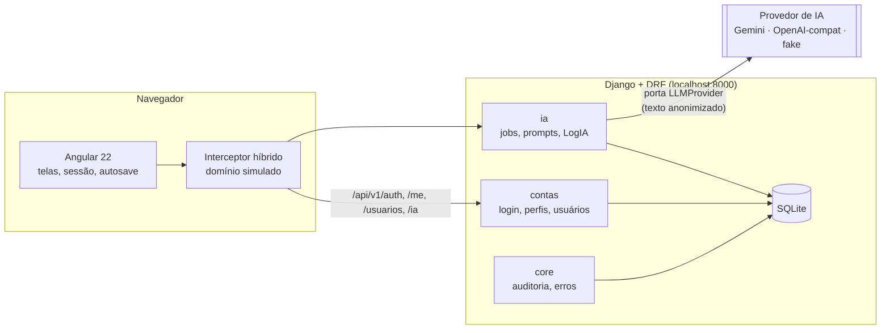

<div align="center">


# NEXUS

**Do pedido ao suporte, sem perder o contexto.**

Plataforma inteligente de apoio ao levantamento, especificação, prototipação e suporte pós-entrega de soluções de software.
<br/>Trabalho de Conclusão de Curso · Análise e Desenvolvimento de Sistemas · UCSal


</div>

---

## 📸 A aplicação

<!-- Coloque aqui o print da tela "Visão geral" (http://localhost:4200/visao-geral), salvo como docs/img/nexus-visao-geral.png -->


<sub>Visão geral (painel) na visão da equipe: indicadores, demandas por etapa, chamados, movimento das últimas semanas e validação humana das sugestões da IA.</sub>

---

## 🎯 Motivação

Durante o desenvolvimento de um sistema, muita informação é produzida: a conversa com o cliente, as atas de reunião, as decisões sobre o tipo de solução, o protótipo, os requisitos aprovados, as versões publicadas. Quando o sistema é entregue e aparece um problema, **quase nada disso chega ao atendimento**. O suporte começa do zero, pergunta de novo o que já foi respondido e resolve o mesmo problema mais de uma vez.

> **Problema:** a dificuldade de preservar, recuperar e usar de forma organizada o contexto produzido durante o desenvolvimento de uma solução de software no atendimento de chamados de suporte.

> **Pergunta de pesquisa:** como uma plataforma que preserva e recupera esse contexto pode auxiliar o atendimento de chamados por meio de IA generativa **com validação humana**?

O NEXUS nasce para ligar essas pontas: o mesmo registro que começa no pedido do cliente acompanha a solução até o suporte e vira conhecimento reutilizável.

---

## 💡 A solução

O NEXUS acompanha uma necessidade de software do começo ao fim:

```mermaid
flowchart LR
    A[📝 Necessidade<br/>texto ou ata] --> B[💬 Entrevista guiada<br/>perguntas simples]
    B --> C[🧭 Tipo de solução<br/>web, desktop, job…]
    C --> D[🖼️ Protótipo<br/>telas em HTML]
    D --> E[📨 Solicitação<br/>à equipe]
    E --> F[✅ Viabilidade,<br/>reunião e metodologia]
    F --> G[📄 Requisitos e<br/>documento]
    G --> H[📦 Solução e<br/>versões]
    H --> I[🎧 Chamado com<br/>contexto + IA]
    I --> J[📚 Conhecimento<br/>validado]
```



### A regra central

<div align="center">

**🤖 IA propõe → 🧑 humano valida → 🗄️ sistema consolida**

</div>

A IA **nunca decide sozinha**. Ela sugere requisitos, possíveis causas e procedimentos; uma pessoa aprova, edita ou rejeita (com motivo). Toda sugestão aparece marcada como **"sugestão ainda não validada"** até alguém da equipe decidir, e cada decisão fica registrada na auditoria.

---

## ✨ O que cada pessoa faz

O NEXUS tem duas visões. Quem é da equipe alterna entre elas no topo da tela (**Cliente | Equipe**); na visão da equipe aparece uma linha roxa no topo.

| | 👤 Cliente | 👥 Equipe | 🛡️ Administrador |
|---|---|---|---|
| **Painel** | Andamento dos próprios pedidos e chamados | Solicitações, validações pendentes, atendimento e indicadores | Igual à equipe |
| **Demandas** | Abre demanda, responde a entrevista guiada, vê o tipo de solução e o protótipo, decide entre stand-by ou enviar | Avalia viabilidade, marca reunião, define metodologia e datas, valida requisitos | Igual à equipe |
| **Requisitos** | Recebe o documento com o que foi aprovado | Pede sugestões à IA e aprova, edita ou rejeita cada uma | Igual à equipe |
| **Soluções** | Vê as que solicitou e as que observa (vínculo pelo e-mail) | Vê todas e gerencia observadores | Igual à equipe |
| **Suporte** | Abre chamado e acompanha a posição na fila | Atende com o contexto recuperado e a sugestão da IA, valida e registra conhecimento | Igual à equipe |
| **Usuários** | — | — | Cadastra pessoas, define perfil, desativa contas e redefine senhas |

### Destaques

| | Recurso | Como funciona |
|---|---|---|
| 💬 | **Entrevista guiada** | Perguntas simples, uma por vez, com 3 ou mais opções e "Outro". As próximas perguntas se adaptam às respostas |
| 🧭 | **Tipo de solução** | Cada resposta gera sinais ("uso no celular", "precisa funcionar offline"); uma regra determinística pontua web, desktop, mobile, rotina agendada e API |
| 🖼️ | **Protótipo seguro** | Telas em HTML puro, sem scripts, exibidas num `iframe` isolado (`sandbox`) |
| 🗂️ | **Etapas claras** | Uma barra única mostra as etapas da demanda (1 a 5), o que já foi feito e o que falta |
| 💾 | **Autosave** | Formulários e a entrevista guardam o que foi digitado; dá para sair e continuar de onde parou |
| 🎧 | **Apoio da IA no suporte** | O chamado recupera demanda, requisitos, versão, chamados anteriores e conhecimento validado; a IA sugere causa provável e procedimento |
| 📚 | **Base de conhecimento** | Só o procedimento aprovado por uma pessoa vira conhecimento, e o número de reusos é contado |
| 📊 | **Painel com indicadores** | Demandas por etapa, chamados por situação, movimento semanal e taxa de aprovação sem edição das sugestões (métrica do TCC) |
| ❓ | **Ajuda guiada** | O botão "Ajuda" percorre a tela atual, passo a passo |

---

## 🧰 Tecnologias

### Frontend

| | Tecnologia | Versão | Para que serve no NEXUS |
|---|---|---|---|
|  | **Angular** (standalone, Signals, Router) | 22 | Toda a interface, com componentes independentes e estado reativo |
|  | **TypeScript** (modo strict) | 6.0 | Tipagem dos contratos da API e das telas |
|  | **RxJS** | 7.8 | Chamadas HTTP, polling das tarefas de IA, busca com espera |
|  | **CSS próprio** com tokens | — | Paleta, modo claro/escuro e componentes únicos por tipo, sem framework visual |
|  | **Node.js / npm** | 24 / 11 | Ferramentas de build e servidor de desenvolvimento |

### Backend

| | Tecnologia | Versão | Para que serve no NEXUS |
|---|---|---|---|
|  | **Python** | 3.14 | Linguagem do backend |
|  | **Django** | 6.1 | Monólito modular: um app por área de negócio (`core`, `contas`, `ia`…) |
|  | **Django REST Framework** | 3.18 | API REST em `/api/v1/`, com serializers de campos explícitos e permissões por objeto |
|  | **Simple JWT** | 5.5 | Login com token de 15 min e renovação rotativa em cookie HttpOnly |
|  | **SQLite** | — | Banco local (temporário; o desenho evita recursos exclusivos de PostgreSQL) |
| 🌐 | **HTTPX** | 0.28 | Chamadas aos provedores de IA |
| ⚙️ | **python-dotenv** | 1.2 | Configuração e segredos no arquivo `.env` |

### Inteligência artificial

| | Peça | O que faz |
|---|---|---|
|  | **Google Gemini** (provedor ativo) | Gera sugestões de requisitos e de suporte. Modelo principal `gemini-3.5-flash-lite`, com modelos de reserva |
| 🔌 | **Porta `LLMProvider`** | Única entrada para a IA. Trocar de provedor é mudar uma linha no `.env` (`gemini`, `openai_compat` ou `fake`) |
| 🧪 | **Adaptador `fake`** | Respostas fixas para testes e demonstração sem internet e sem custo |
| 📐 | **Esquema JSON** | Toda resposta da IA é validada antes de ser salva; fora do formato, a tarefa falha com mensagem clara |
| 🕵️ | **Anonimização (LGPD)** | Nomes, e-mails e telefones são mascarados antes de qualquer envio ao provedor |
| 📝 | **Prompts versionados + LogIA** | Cada prompt tem versão no banco; cada execução registra modelo, tokens, duração e custo |
| ⏳ | **Tarefas longas** | Geração assíncrona: a API responde `202` com um job, e a tela acompanha o andamento |

---

## 🏛️ Arquitetura



- **Monólito modular:** cada módulo tem camadas separadas (API → serviços → domínio → infraestrutura) e **nunca importa os models de outro módulo**.
- **Front e API na mesma origem:** o servidor do Angular (porta 4200) repassa `/api` para o Django (porta 8000).
- **Migração gradual:** as partes ainda não migradas respondem pelo interceptor do front; à medida que cada módulo chega ao Django, a rota simulada é removida.

---

## 🔒 Segurança e privacidade

| | Cuidado | Como |
|---|---|---|
| 🔑 | Sessão | Token de acesso de 15 min só em memória; renovação rotativa em cookie HttpOnly, revogada ao sair |
| 🚧 | Permissão | Por perfil e por registro: o cliente só vê o que é dele (ou o que observa) |
| 🛡️ | Ataques comuns | Checagem de origem nas rotas de login, limite de tentativas, nenhum SQL montado com texto do usuário |
| 🧾 | Auditoria | Registro somente de inclusão (append-only) de logins, decisões, alterações de usuário e redefinição de senha |
| 🕵️ | LGPD | Dados pessoais anonimizados antes de irem para a IA; o original fica na plataforma |
| 🖼️ | Protótipo | HTML sem scripts, em `iframe sandbox` |

---

## 🚀 Como rodar

Resumo rápido (são dois terminais). O passo a passo completo, com `.env`, IA real, testes e problemas comuns, está em **[docs/COMO_RODAR.md](docs/COMO_RODAR.md)**.

```bash
# Terminal 1: backend (primeira vez: venv, pip install, .env, migrate e seed_demo; veja o guia)
cd backend
venv\Scripts\activate          # Windows · Linux/macOS: source venv/bin/activate
python manage.py runserver        # http://localhost:8000
```

```bash
# Terminal 2: frontend
cd frontend
npm ci                            # só na primeira vez
npm start                         # http://localhost:4200
```

Abra **http://localhost:4200** e entre com `EquipeAdmin` / `123` (equipe) ou `Usuario` / `123` (cliente). Contas só de demonstração.

---

## 📊 Estado atual

| Parte | Situação |
|---|---|
| Login, cadastro, perfis e gestão de usuários | ✅ **Real** no Django |
| IA (requisitos e sugestão de suporte) | ✅ **Real** (Gemini), com anonimização e validação humana |
| Demandas, entrevista, tipo de solução, protótipo, calendário, soluções e chamados | 🧪 **Simulado** no navegador, com o mesmo contrato da API (em migração para o Django) |
| Testes do backend | ✅ 162 testes automatizados passando |

> Os dados de demonstração são **fictícios** e não representam resultados experimentais do TCC.

---

## 📁 Estrutura do repositório

```
nexus-ia/
├── frontend/        Angular 22 (core · shared · features)
├── backend/         Django 6.1 + DRF (apps: core, contas, ia)
├── docs/            documentação oficial
├── CLAUDE.md        especificação mestra do projeto
└── README.md
```

## 📚 Para saber mais

| Documento | Conteúdo |
|---|---|
| [🚀 Como rodar](docs/COMO_RODAR.md) | Passo a passo para instalar e executar em localhost |
| [📐 Arquitetura](docs/ARQUITETURA.md) | Arquitetura de software (resumo de [`docs/Nexus_Arquitetura.pdf`](docs/Nexus_Arquitetura.pdf)) |
| [🔀 Fluxo](docs/FLUXO.md) | Fluxo funcional ponta a ponta |
| [🗃️ Modelo de dados](docs/MODELO_DADOS.md) | Entidades por módulo |
| [📌 Status](docs/STATUS_PROJETO.md) | Fase atual e decisões |
| [📜 Especificação mestra](CLAUDE.md) | Escopo, regras, fluxo, padrão visual e decisões em aberto |
| [🗂️ Histórico do MVP anterior](docs/historico/) | Registro acadêmico da primeira versão |
