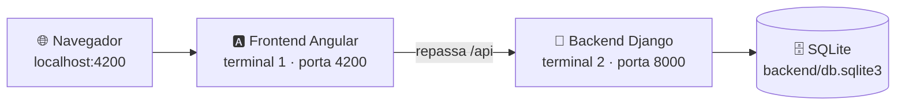

<div align="center">


# 🚀 Como rodar o NEXUS

Guia passo a passo para instalar e executar o projeto no seu computador (**localhost**).


</div>

---

## 🗺️ Visão geral

O NEXUS tem duas partes, e as duas precisam estar rodando ao mesmo tempo, **cada uma no seu terminal**:



| | Parte | Pasta | Porta | Comando do dia a dia |
|---|---|---|---|---|
| 🐍 | Backend (API) | `backend/` | 8000 | `python manage.py runserver` |
| 🅰️ | Frontend (telas) | `frontend/` | **4200** (obrigatória) | `npm start` |

> ⚠️ **Abra sempre `http://localhost:4200`.** O Angular repassa `/api` para o Django, e assim os dois ficam na mesma origem. O login recusa outras portas e endereços por segurança.

---

## ✅ 1. Pré-requisitos

| | Programa | Versão | Como conferir |
|---|---|---|---|
|  | Node.js | 24.x | `node --version` |
|  | npm (vem com o Node) | 11 | `npm --version` |
|  | Python | 3.14 | `python --version` |
|  | Git | qualquer | `git --version` |

Você não precisa de Docker nem de banco instalado: o banco é um arquivo SQLite criado na hora.

---

## 📥 2. Baixar o projeto

```bash
git clone git@github.com:DanNves/nexus-ia.git
cd nexus-ia
```

---

## 🐍 3. Backend: primeira vez

Abra um terminal **na pasta do projeto** e entre em `backend/`:

```bash
cd backend
```

### 3.1 Criar e ativar o ambiente virtual

O ambiente virtual (`venv`) guarda as bibliotecas do projeto separadas do resto do computador.

```bash
python -m venv venv
```

Ative conforme o seu terminal:

| Terminal | Comando para ativar |
|---|---|
| 🪟 PowerShell | `venv\Scripts\Activate.ps1` |
| 🪟 Prompt de comando (cmd) | `venv\Scripts\activate` |
| 🪟 Git Bash | `source venv/Scripts/activate` |
| 🐧 Linux / 🍎 macOS | `source venv/bin/activate` |

Ativou certo quando aparece **`(venv)`** no começo da linha do terminal.

### 3.2 Instalar as dependências

```bash
pip install -r requirements/base.txt
```

### 3.3 Criar o arquivo `.env`

O `.env` guarda as configurações e os segredos. Ele **não vai para o Git**. Copie o modelo:

| Terminal | Comando |
|---|---|
| PowerShell | `Copy-Item .env.example .env` |
| cmd | `copy .env.example .env` |
| Git Bash / Linux / macOS | `cp .env.example .env` |

Gere uma chave secreta nova:

```bash
python -c "from django.core.management.utils import get_random_secret_key as g; print(g())"
```

Abra o `.env` e cole o resultado em `DJANGO_SECRET_KEY=`. Para começar sem IA real (sem internet e sem custo), deixe `IA_PROVEDOR=fake`.

### 3.4 Criar o banco e os usuários de demonstração

```bash
python manage.py migrate
python manage.py seed_demo
```

O `seed_demo` cria duas contas, **só para demonstração** (funciona apenas com `DJANGO_DEBUG=True`):

| | Usuário | Senha | Perfil | Nome na demonstração |
|---|---|---|---|---|
| 🛡️ | `EquipeAdmin` | `123` | Equipe + administrador | Rafael Lima |
| 👤 | `Usuario` | `123` | Cliente | Marina Costa |

### 3.5 Subir o backend

```bash
python manage.py runserver
```

Deixe este terminal aberto. A API fica em `http://localhost:8000`.

---

## 🅰️ 4. Frontend: primeira vez

Abra um **segundo terminal**, na pasta do projeto:

```bash
cd frontend
npm ci
npm start
```

| Comando | O que faz |
|---|---|
| `npm ci` | Instala as dependências exatamente nas versões do `package-lock.json` (só na primeira vez ou quando o lock mudar) |
| `npm start` | Sobe o servidor de desenvolvimento em `http://localhost:4200`, recarregando a tela a cada alteração |

---

## 🎉 5. Acessar

1. Abra **http://localhost:4200**.
2. Entre com `EquipeAdmin` / `123` (equipe) ou `Usuario` / `123` (cliente).
3. Clique em **Ajuda** (no topo) para um tour pela tela atual.

> 💡 Entrando como **EquipeAdmin**, use o seletor **Cliente | Equipe** no topo para ver o sistema como um cliente vê. Na visão da equipe aparece uma linha roxa no topo e o item **Usuários**.

---

## 🔁 Dia a dia (depois da primeira vez)

São só dois terminais:

```bash
# Terminal 1: backend
cd backend
venv\Scripts\activate        # ou: source venv/Scripts/activate (Git Bash) · source venv/bin/activate (Linux/macOS)
python manage.py runserver
```

```bash
# Terminal 2: frontend
cd frontend
npm start
```

Para parar, aperte **Ctrl + C** em cada terminal.

---

## 🤖 IA: com ou sem modelo real

A IA é escolhida no `backend/.env`, na variável `IA_PROVEDOR`. Depois de mudar, reinicie o backend.

| Modo | `IA_PROVEDOR` | Precisa de | Quando usar |
|---|---|---|---|
| 🧪 Simulada | `fake` | nada | Testes, demonstração offline, desenvolvimento sem gastar |
|  Gemini | `gemini` | `GEMINI_API_KEY` | IA real (free tier). Chave em [aistudio.google.com](https://aistudio.google.com/) |
| 🔌 Compatível com OpenAI | `openai_compat` | `OPENAI_COMPAT_API_KEY` e `OPENAI_COMPAT_URL_BASE` | OpenAI, Groq, DeepSeek, Mistral, OpenRouter, Ollama… |

Exemplo com Gemini:

```ini
IA_PROVEDOR=gemini
IA_MODELO=gemini-3.5-flash-lite
IA_MODELOS_RESERVA=gemini-3.8-flash,gemini-3.6-flash
GEMINI_API_KEY=cole-sua-chave-aqui
```

Conferir se o provedor responde e medir a qualidade:

```bash
python manage.py ia_testar                         # uma geração de teste (padrão: requisitos)
python manage.py ia_testar --tarefa sugestao_suporte
python manage.py ia_avaliar                        # roda os casos de avaliação de qualidade
```

> 🕵️ Antes de ir para a IA, nomes, e-mails e telefones são anonimizados. Mesmo assim, **use só dados fictícios** com o free tier: o provedor pode usar o conteúdo enviado.

---

## 🧪 Testes e qualidade

| Onde | Comando | O que verifica |
|---|---|---|
| `frontend/` | `npm run check` | Regras do projeto (sem `!important`, `100vh` ou `$any()`) |
| `frontend/` | `npm run build` | Compilação completa, com checagem de tipos |
| `backend/` | `python manage.py check` | Configuração do Django |
| `backend/` | `python manage.py makemigrations --check` | Se algum model mudou sem migração |
| `backend/` | `python manage.py test` | Os testes automatizados (162 hoje) |

Build e testes passando são requisito para aceitar uma entrega.

---

## 🧰 Comandos úteis

| Comando (em `backend/`, com o venv ativo) | Para quê |
|---|---|
| `python manage.py seed_demo` | Recria/restaura as contas `EquipeAdmin` e `Usuario` com senha `123` |
| `python manage.py createsuperuser` | Cria um administrador do painel do Django |
| `python manage.py runserver 8000` | Sobe a API numa porta específica |
| `http://localhost:8000/admin/` | Painel administrativo do Django |

| Na tela | Para quê |
|---|---|
| Menu do usuário → **Restaurar dados de demonstração** (visão da equipe) | Volta demandas, chamados, soluções e calendário ao estado inicial e limpa os rascunhos |
| **Ctrl + K** | Busca global |
| Menu do usuário → **Modo escuro** | Alterna o tema |

---

## 🩺 Problemas comuns

| Sintoma | Causa provável | Como resolver |
|---|---|---|
| "Não foi possível falar com o servidor" | Backend parado | Suba o terminal 2: `python manage.py runserver` |
| Login responde "Requisição de origem não permitida" | Front aberto fora de `localhost:4200` | Use exatamente `http://localhost:4200` |
| `npm start` diz que a porta 4200 está em uso | Outro `ng serve` ainda aberto | Feche o outro terminal ou encerre o processo na porta 4200 |
| PowerShell bloqueia o `Activate.ps1` | Política de execução do Windows | `Set-ExecutionPolicy -Scope CurrentUser RemoteSigned` e tente de novo |
| `seed_demo` diz que foi bloqueado | `DJANGO_DEBUG=False` no `.env` | Use `DJANGO_DEBUG=True` em desenvolvimento |
| "Muitas tentativas em pouco tempo" | Limite de login (10/min por IP) | Espere um minuto ou ajuste `API_LIMITE_AUTH` no `.env` |
| A IA falha ou demora | Free tier ocupado ou chave inválida | Rode `python manage.py ia_testar`; para demonstrar sem internet, use `IA_PROVEDOR=fake` |
| Os dados sumiram ou estão diferentes em outro navegador | O domínio ainda simulado fica guardado **só neste navegador** | Normal nesta fase; restaure pelo menu do usuário se precisar |
| `ModuleNotFoundError` no backend | venv não ativado | Ative o venv (veja o passo 3.1) e rode de novo |

---

## ⚙️ Principais variáveis do `.env`

| Variável | Padrão | O que controla |
|---|---|---|
| `DJANGO_SECRET_KEY` | — | Chave secreta do Django (**obrigatório trocar**) |
| `DJANGO_DEBUG` | `True` | Modo de desenvolvimento. Com `False`, o cookie de sessão exige HTTPS |
| `DJANGO_ALLOWED_HOSTS` | `localhost,127.0.0.1` | Endereços aceitos pela API |
| `DJANGO_DB_NOME` | `db.sqlite3` | Arquivo do banco, dentro de `backend/` |
| `AUTH_ORIGENS_PERMITIDAS` | `http://localhost:4200,…` | De onde o login é aceito |
| `API_LIMITE_AUTH` | `10/min` | Tentativas de login/cadastro por IP |
| `IA_PROVEDOR` | `fake` | `fake`, `gemini` ou `openai_compat` |
| `IA_MODELO` / `IA_MODELOS_RESERVA` | Gemini Flash Lite / reservas | Modelo principal e modelos tentados em caso de falha |
| `IA_LIMITE_POR_USUARIO` | `10/min` | Pedidos de geração por usuário |
| `IA_COTA_POR_ALVO` | `20` | Gerações por demanda ou chamado |

A lista completa, com comentários, está em [`backend/.env.example`](../backend/.env.example).

---

<div align="center">

[🏠 Voltar à apresentação do projeto (README)](../README.md) · [📚 Índice da documentação](README.md)

</div>
